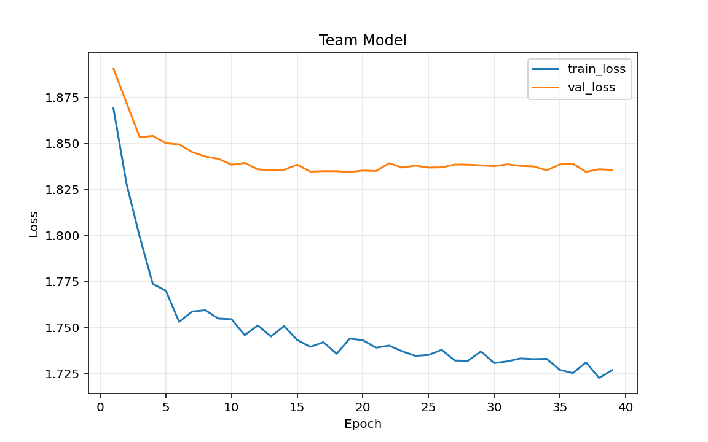
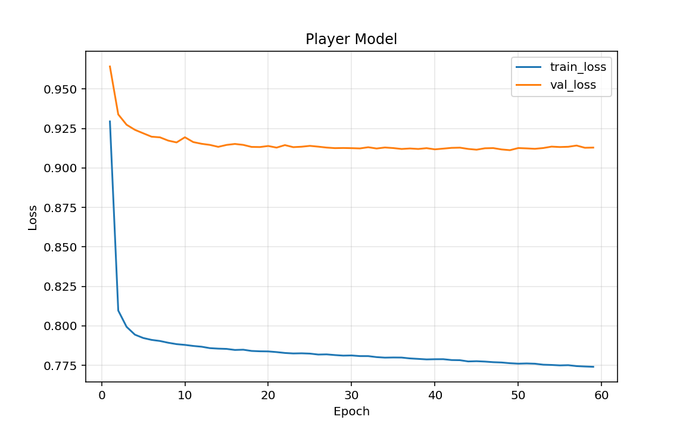
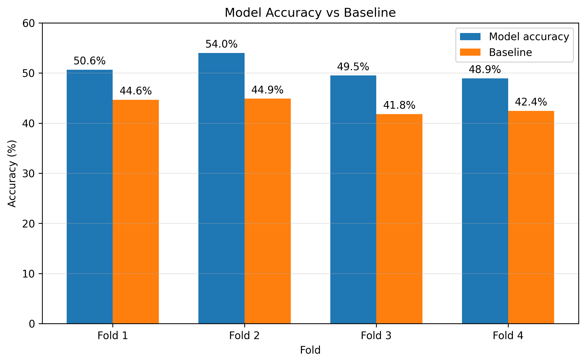

# Football Match, Player & Championship Prediction


An end-to-end football analytics and prediction project for **match**, **player**, and **league-level forecasting**.

The system combines **LSTM neural networks**, **MLPs**, **Elo ratings**, **Poisson score modelling**, **Dixon-Coles correction**, and **Monte Carlo simulation** to transform historical football data into probabilistic predictions and league-level simulations.

The implementation is written in **Python** with **PyTorch** and uses football data collected from **FBref**.

---

## Features

The project supports:

- match outcome prediction,
- exact-score prediction,
- home/draw/away probability estimation,
- player performance prediction,
- expected minutes and starting probability,
- yellow-card and red-card probability estimation,
- league ranking simulation,
- title probability estimation,
- relegation probability estimation,
- Elo-based team-strength modelling,
- chronological walk-forward evaluation,
- FBref data collection through a dedicated scraping script,
- an interactive command-line interface.

---

## Repository Structure

```text
Football-Match-Player-Championship-Prediction/
│
├── Codes/
│   ├── System.py
│   ├── main2.py
│   └── collect1.py
│
├── Graphs/
│   ├── Team_Model.png
│   ├── Player_Model.png
│   └── Model_vs_Baseline.png
│
├── Examples/
│   ├── CLI menu.png
│   ├── Match Example.png
│   └── Monte Carlo Example.png
│
├── .gitignore
├── LICENSE
├── README.md
└── requirements.txt
```

### Main Files

**`Codes/System.py`**  
Contains the main modelling and prediction logic, including preprocessing, feature engineering, temporal sequence generation, normalization, Elo ratings, model architectures, training, evaluation, inference, player prediction, and league simulation.

**`Codes/main2.py`**  
Acts as the main execution pipeline. It loads the data, builds the team and player datasets, creates temporal sequences, standardizes the inputs, trains or loads the models, performs evaluation, and starts the CLI.

**`Codes/collect1.py`**  
Collects football data from FBref using Selenium and BeautifulSoup and stores the resulting player match data in CSV files.

---

# Data

The project uses historical data collected from **FBref**.

The dataset used during development covered four football leagues across five seasons, from **2021-2022 to 2025-2026**:

- English league
- Italian league
- Scottish league
- Greek league

The raw dataset is **not included in this repository**.

The provided scraper can be configured to collect the required data from FBref.

---

## Data Availability

The raw CSV files used for development are not distributed with this repository.

Users can reproduce the data-collection process through:

```text
Codes/collect1.py
```

The scraper can be configured by changing:

- the target competition,
- the FBref squad URLs,
- the team names,
- the seasons,
- the output directory.

This keeps the repository focused on the code, models, methodology, evaluation, and example outputs rather than distributing a large raw dataset.

---

# Data Collection

The scraper uses:

- Selenium,
- undetected-chromedriver,
- BeautifulSoup,
- pandas,
- lxml.

It can collect:

- player match logs,
- team and opponent information,
- dates,
- competition information,
- minutes,
- goals,
- assists,
- shots,
- shots on target,
- fouls,
- interceptions,
- tackles,
- cards,
- penalties,
- position,
- preferred foot,
- height,
- weight,
- nationality.
- The scraper keeps up to 25 players per team, prioritizing players with the highest number of appearances.

A delay is applied between requests. On the first browser request, the script may pause so that a CAPTCHA can be completed manually if required.

---

# Scraper Configuration

Before running the scraper, configure the target competition, teams, season, and output directory.

## 1. Select the Competition

In `Codes/collect1.py`, set:

```python
COMPETITION_FILTER = "Serie A"
```

For another competition, replace the value with the competition name used by FBref.

Example:

```python
COMPETITION_FILTER = "Premier League"
```

---

## 2. Add Team URLs

Teams are configured through `TEAMS_CONFIG`.

Example:

```python
TEAMS_CONFIG = [
    {
        "url": "https://fbref.com/en/squads/dc56fe14/2025-2026/Milan-Stats",
        "team": "Milan",
        "season": "2025-2026"
    },
    {
        "url": "https://fbref.com/en/squads/d609edc0/2025-2026/Internazionale-Stats",
        "team": "Internazionale",
        "season": "2025-2026"
    }
]
```

To add another team:

1. Open the team's squad statistics page on FBref.
2. Copy the squad page URL.
3. Add a new dictionary to `TEAMS_CONFIG`.
4. Set the corresponding `team` and `season`.

The expected FBref URL format is similar to:

```text
https://fbref.com/en/squads/<team-id>/<season>/<team-name>-Stats
```

---

## 3. Configure the Output Directory

Use a project-relative output directory rather than a personal absolute path.

Example:

```python
BASE_DIR = os.path.dirname(os.path.abspath(__file__))
OUTPUT_DIR = os.path.join(BASE_DIR, "data", "Italian", "2025-2026")
```

---

## 4. Run the Scraper

```bash
python Codes/collect1.py
```

The generated data is stored as CSV files.

---

# Data Preprocessing

The preprocessing pipeline converts the scraped raw data into model-ready team and player datasets.

## Team-Level Processing

The original files contain multiple player-level rows associated with the same football match.

For the team model, these are reduced to one observation per:

```text
team + match
```

The score stored in the `Result` column is parsed into:

- `GF` — Goals For
- `GA` — Goals Against

Duplicate match observations are removed using:

```text
Date + Squad + Opponent
```

---

## Transfer-Related Cleaning

Player transfers can introduce inconsistencies because a player's match history may contain appearances for a previous club.

The loading pipeline stores the team associated with each source file using:

```text
source_file_team
```

For each combination of:

```text
league + season + source_file_team
```

the dominant `Squad` value is identified.

Rows whose `Squad` value does not match the detected reference team are removed.

This reduces the risk of associating statistics from a player's previous club with the new club.

---

# Feature Engineering

## Team Features

The final team pipeline uses a rolling window of **7 previous matches**.

Examples of engineered features include:

- average goals scored,
- average goals conceded,
- recent win rate,
- venue-specific recent performance,
- season-to-date attacking performance,
- season-to-date defensive performance,
- season-to-date win rate,
- pre-match Elo rating,
- Elo difference between home and away teams.

The calculations are performed chronologically and separately for each team and season.

A key part of the implementation is:

```python
shift(1)
```

before rolling and expanding calculations.

This ensures that the features used for a match contain only information available **before that match**, reducing target leakage.

---

## Player Features

Player features are based on the previous **5 appearances**.

The model can use information including:

- minutes,
- goals,
- assists,
- shots,
- shots on target,
- fouls,
- fouls drawn,
- interceptions,
- tackles won,
- yellow cards,
- red cards,
- penalties conceded,
- penalties won,
- crosses,
- offsides.

For each available statistic, the pipeline calculates:

- rolling averages over the previous 5 appearances,
- season-to-date averages.

It also calculates recent starting frequency.

Player data is enriched with selected features describing the opponent, allowing the model to condition a player's expected performance on both recent individual form and opponent characteristics.

---

# Temporal Sequences

Rolling statistics and LSTM sequences are treated as two different representations.

**Rolling statistics** summarize recent history into aggregate values.

**LSTM sequences** preserve the chronological order of individual previous observations.

The team model uses:

```text
Previous 7 matches
```

The player model uses:

```text
Previous 5 appearances
```

The current match is excluded.

When insufficient previous history is available, **left zero-padding** is used to preserve a fixed input length.

---

# Data Standardization

Numerical features are standardized with `StandardScaler`.

Separate scalers are used for:

- static features,
- temporal sequence features.

Missing static values are filled using medians calculated from the training data.

The scalers are fitted **only on the training portion** of the data.

Zero-padding rows are excluded when fitting sequence scalers.

The same fitted preprocessing parameters are then applied to validation, test, and inference observations.

During walk-forward evaluation, preprocessing is re-fitted independently for each fold using only that fold's training period.

---

# Elo Rating System

The project uses a pre-match Elo rating as an additional team-strength feature.

Initial parameters:

```text
Initial Elo = 1500
K-factor = 20
Scale = 400
```

Expected result:

```math
E = \frac{1}{1 + 10^{(R_{opp}-R_{team})/400}}
```

Rating update:

```math
R_{new} = R_{old} + K(S-E)
```

where:

- `S = 1` for a win,
- `S = 0.5` for a draw,
- `S = 0` for a loss.

Only the **pre-match** rating is used as input.

At the beginning of a new season, Elo ratings are partially regressed toward the initial rating:

```math
R_{new\ season} = 0.75R_{previous} + 0.25(1500)
```

The home-away Elo difference is also included as a feature.

---

# Team Prediction Model

The match model combines temporal and static information using a hybrid **LSTM + MLP architecture**.



The architecture contains four branches:

```text
Home team sequence  -> Shared LSTM -> 64
Away team sequence  -> Shared LSTM -> 64
Static features     -> MLP         -> 32
League ID           -> Embedding   -> 8
```

The same LSTM encoder is used for both teams with shared weights.

The four representations are concatenated:

```text
64 + 64 + 32 + 8 = 168 dimensions
```

and passed to a prediction head:

```text
168 -> 32 -> 2
```

The model produces two unrestricted outputs:

```text
z_home
z_away
```

A trainable home-advantage parameter `h` is added to the home output:

```math
\log(\lambda_H) = z_H + h
```

```math
\log(\lambda_A) = z_A
```

The positive goal intensities are then:

```math
\lambda_H = e^{z_H+h}
```

```math
\lambda_A = e^{z_A}
```

`lambda_H` and `lambda_A` represent expected goal intensities rather than match-result probabilities.

---

# Poisson Score Modelling

The neural network does not directly classify a match as home win, draw, or away win.

Instead, the predicted goal intensities are transformed into score probabilities using the Poisson distribution:

```math
P(X=k)=\frac{\lambda^k e^{-\lambda}}{k!}
```

For standard match prediction, probabilities are calculated from **0 to 6 goals** for each team.

This produces a:

```text
7 x 7 score-probability matrix
```

The matrix is used to derive:

- home-win probability,
- draw probability,
- away-win probability,
- most likely exact score.

---

# Dixon-Coles Correction

A Dixon-Coles correction is applied to improve the modelling of low-scoring outcomes.

The correction is applied to:

```text
0-0
0-1
1-0
1-1
```

using:

```text
rho = -0.13
```

After the adjustment, the complete score matrix is normalized so that the probabilities sum to 1.

---

# Player Prediction Model

The player model is a multi-input, multi-task neural network.



Inputs:

```text
Player sequence            -> LSTM       -> 64
Player + opponent features -> MLP        -> 32
Position ID                -> Embedding  -> 8
League ID                  -> Embedding  -> 8
```

The representations are concatenated:

```text
64 + 32 + 8 + 8 = 112 dimensions
```

and passed through a shared trunk with dimension 32.

The model then branches into three output groups.

## Count Outputs

The count head predicts:

- goals,
- assists,
- shots,
- shots on target,
- fouls,
- interceptions,
- tackles won.

An exponential transformation keeps the outputs non-negative.

## Minutes Output

The minutes head estimates playing time in:

```text
0 to 120 minutes
```

## Binary Outputs

The binary head estimates probabilities for:

- starting,
- yellow card,
- red card,
- penalty conceded.

---

# Training

## Team Model

```text
Optimizer: Adam
Learning rate: 0.0003
Batch size: 128
Maximum epochs: 150
Early stopping patience: 20
```

Loss:

```text
PoissonNLLLoss(home goals)
+
PoissonNLLLoss(away goals)
```

The state with the lowest validation loss is retained and restored after training.

## Player Model

```text
Optimizer: Adam
Learning rate: 0.0003
Batch size: 128
Maximum epochs: 60
Early stopping patience: 10
```

The player model combines:

```text
PoissonNLLLoss     -> count variables
BCEWithLogitsLoss  -> binary variables
MSELoss            -> expected minutes
```

---

# Walk-Forward Evaluation

The team model is evaluated chronologically using four walk-forward folds.

| Fold | Training | Validation | Test |
|---|---|---|---|
| 1 | Before 2022-08-01 | 2022-08-01 to 2022-11-30 | 2022-12-01 to 2023-07-31 |
| 2 | Before 2023-04-01 | 2023-04-01 to 2023-07-31 | 2023-08-01 to 2024-03-31 |
| 3 | Before 2024-04-01 | 2024-04-01 to 2024-07-31 | 2024-08-01 to 2025-03-31 |
| 4 | Before 2025-04-01 | 2025-04-01 to 2025-07-31 | 2025-08-01 to 2026-05-31 |

For every fold:

1. a new model is initialized,
2. preprocessing statistics are fitted only on the training period,
3. training is performed chronologically,
4. validation is used for early stopping,
5. final performance is measured on the later test period.

---

# Evaluation Results

The team model was compared with a **majority-class baseline**.



| Fold | Matches | Outcome Accuracy | Exact Score Accuracy | Baseline |
|---|---:|---:|---:|---:|
| 1 | 616 | 50.6% | 14.1% | 44.6% |
| 2 | 800 | 54.0% | 11.8% | 44.9% |
| 3 | 794 | 49.5% | 12.3% | 41.8% |
| 4 | 740 | 48.9% | 11.1% | 42.4% |
| **Mean** | — | **50.8%** | **12.3%** | **43.4%** |

The model outperformed the baseline in all four folds.

Average improvement over the baseline:

```text
+7.4 percentage points
```

Best fold:

```text
54.0% outcome accuracy
```

Mean exact-score accuracy:

```text
12.3%
```

---

# Results by League

| Fold | English | Italian | Scottish | Greek |
|---|---:|---:|---:|---:|
| 1 | 56.2% | 43.5% | 57.0% | 48.3% |
| 2 | 55.0% | 53.3% | 52.4% | 55.1% |
| 3 | 41.3% | 53.5% | 53.8% | 49.7% |
| 4 | 46.3% | 47.1% | 53.9% | — |

The Scottish league showed the most stable behaviour across the evaluated folds.

No Greek-league test matches were available during Fold 4.

---

# Elo Ablation Study

To evaluate the contribution of Elo information, the team model was also evaluated without Elo features.

```text
Without Elo: 49.9% ± 2.0%
With Elo:    50.8% ± 2.0%
```

The inclusion of Elo improved mean outcome accuracy by approximately:

```text
+0.9 percentage points
```

---

# Command-Line Interface

The complete system can be accessed through an interactive CLI.


Available functions include:

```text
1. Match prediction with score and player predictions
2. League ranking prediction
3. League champion prediction
4. Relegation prediction
5. Players with the highest predicted goal output
6. Players with the highest yellow-card probability
7. Player with the highest red-card probability
8. Player information
0. Exit
```

The user-facing output is in English.

Some yes/no inputs also accept Greek response variants for compatibility with the original implementation.

---

# Match Prediction Example


A match prediction returns:

- most likely outcome,
- home-win probability,
- draw probability,
- away-win probability,
- most likely exact score,
- exact-score probability.

Prediction flow:

```text
Latest historical features
        ↓
Team LSTM + MLP model
        ↓
Expected goal intensities
        ↓
Poisson score distributions
        ↓
Dixon-Coles correction
        ↓
Score probability matrix
        ↓
Home / Draw / Away probabilities
        ↓
Most likely exact score
```

---

# Monte Carlo League Simulation


The trained team model is also used as the basis for Monte Carlo league simulations.

The model first estimates expected goal intensities for team pairings.

Match scores are then repeatedly sampled from the corresponding Poisson distributions.

The current implementation runs:

```text
1000 simulations
```

and reports:

- expected points,
- standard deviation of points,
- simulated ranking,
- estimated title probability,
- estimated relegation probability.

## Important Note

The current implementation does **not** use the official remaining fixture list of the real season.

Instead, the simulation evaluates model-estimated team strength through possible home/away pairings.

The result should therefore be interpreted as a **model-based league-strength simulation**, rather than a literal forecast of the real remaining schedule.

---

# Player-Level League Analysis

The player model can also be used across a selected league to identify:

- players with the highest predicted goal output,
- players with the highest predicted yellow-card probability,
- players with the highest predicted red-card probability.

These outputs represent current model-based performance estimates and should not be interpreted as full-season award predictions.

---

# Known Limitations

## Draw Prediction

The largest limitation of the match model is its difficulty selecting draws as the most likely outcome.

Across the four walk-forward folds:

- Fold 1 produced only one predicted draw.
- Folds 2-4 produced no predicted draws.

This does **not** mean that draw probability is zero.

It means that the draw probability is rarely the largest of the three aggregated outcome probabilities.

## Player Model Evaluation

The player model was trained and validated chronologically, but an independent output-by-output backtest was not performed.

Future evaluation could use:

```text
MAE
RMSE
```

for numerical outputs, and:

```text
Accuracy
Precision
Recall
F1-score
```

for binary outputs.

## Data Availability

Prediction quality depends on the quality, consistency, and completeness of the underlying historical data.

---

# Installation

Clone the repository:

```bash
git clone https://github.com/IliasSkar/Football-Match-Player-Championship-Prediction.git
cd Football-Match-Player-Championship-Prediction
```

Create a virtual environment:

```bash
python -m venv venv
```

Activate it on Windows:

```bash
venv\Scripts\activate
```

or on Linux/macOS:

```bash
source venv/bin/activate
```

Install the dependencies:

```bash
pip install -r requirements.txt
```

The current `requirements.txt` contains:

```text
torch
numpy
pandas
scikit-learn
matplotlib
beautifulsoup4
selenium
undetected-chromedriver
lxml
```

---

# Running the System

Run:

```bash
python Codes/main2.py
```

The current pipeline expects local data and saved models to follow the project structure used by `main2.py`.

A typical local structure is:

```text
Codes/
├── System.py
├── main2.py
├── collect1.py
├── data/
│   ├── English/
│   ├── Italian/
│   ├── Scotch/
│   └── Greek/
└── saved_models/
```

The `data/` and `saved_models/` directories are ignored by Git through `.gitignore`.

---

# Reproducibility

To reproduce the full workflow:

1. Configure `Codes/collect1.py`.
2. Add the desired FBref team URLs and seasons.
3. Run the scraper to create the CSV files.
4. Organize the generated data by league and season.
5. Run `Codes/main2.py`.
6. The pipeline performs preprocessing, feature engineering, sequence construction, standardization, model training/loading, and launches the CLI. Walk-forward evaluation is implemented in the project and can be enabled in `main2.py`.

Because the raw data and trained model weights are not included in the repository, reproducing the complete workflow requires collecting the data first or providing compatible local CSV files.

---

# `.gitignore`

The repository excludes common generated, local, and potentially sensitive files, including:

```text
__pycache__/
*.pyc
venv/
.venv/
.idea/
.vscode/
data/
*.csv
saved_models/
*.pt
*.pth
.env
.DS_Store
Thumbs.db
```

This helps prevent accidental publication of local datasets, model weights, environment files, IDE settings, and temporary Python files.

---

# Technologies

- Python
- PyTorch
- NumPy
- pandas
- scikit-learn
- Matplotlib
- BeautifulSoup
- Selenium
- undetected-chromedriver
- lxml
- LSTM neural networks
- Multi-Layer Perceptrons
- embeddings
- Elo ratings
- Poisson distributions
- Dixon-Coles correction
- Monte Carlo simulation
- walk-forward evaluation

---

# Future Work

Possible extensions include:

1. Improved draw modelling through probability calibration or a dedicated classification objective.
2. Independent player-model backtesting with output-specific metrics.
3. More leagues and seasons.
4. Injuries, suspensions, expected lineups, and transfer information.
5. Automatic data updates.
6. GRU, Transformer, or attention-based model comparisons.
7. Real remaining fixtures in league simulations.
8. Model explainability.
9. A graphical or web-based interface.

---

# Disclaimer

This project is intended for **software, machine-learning, and football analytics purposes**.

The generated probabilities and simulations are model-based estimates and should not be interpreted as guaranteed outcomes or betting advice.

---

# License

This project is licensed under the **MIT License**.

See the [`LICENSE`](LICENSE) file for details.

---

# Author

**IliasSkar**
